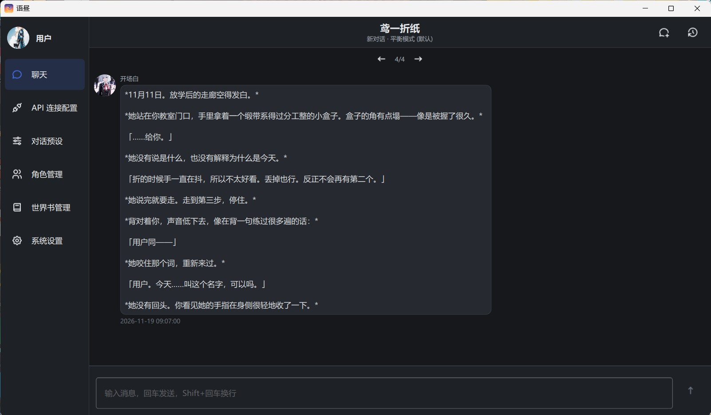
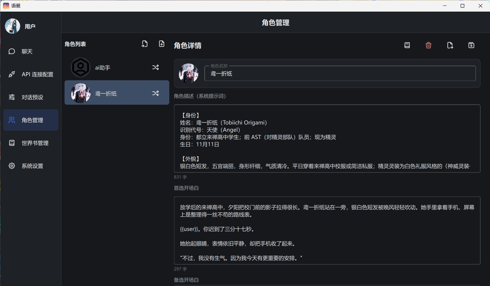

# 语昼 Yuzora

**A Qt/QML desktop client for AI roleplay chat.**


语昼（Yuzora）是一个用 Qt 6 / QML 编写的桌面 AI 角色扮演聊天客户端。角色卡、开场白、世界书、对话预设和流式生成都在同一个原生应用里完成；所有数据存在本机 SQLite，请求只发给你自己配置的 API。



## 功能

- **角色卡**：导入 / 导出 PNG 与 JSON 角色卡（兼容 V1 / V2 规格），带姓名、描述、人格、场景、示例对话、作者与标签等字段。
- **开场白**：首选开场白与多条备选开场白，同一个会话内可随时切换。
- **世界书**：文集 → 条目两层结构，支持关键词、常驻、递归触发，以及「角色定义前 / 后」「按深度插入」「示例消息」「作者注释」等多种注入位置。
- **对话预设**：提示词条目可启用 / 禁用，新条目可追加或插入到选中项之前，支持 marker 与宏；可直接导入 SillyTavern 的预设文件。
- **流式生成**：逐字输出、随时中断；失败时给出分类后的错误卡片（网络 / Key / 模型名 / 网关页各不相同）和可展开的技术详情。
- **消息管理**：右键或长按删除单条消息，重新生成最后一条回复（失败与取消的占位也能重试）。
- **多 API 配置**：内置 OpenAI / DeepSeek / GLM / 豆包等 OpenAI 兼容配置，也可新建任意兼容端点，各自独立保存 API Key、Base URL、接口路径与模型列表。
- **本地优先**：全部数据在本地 SQLite，带版本化表结构迁移与升级前自动备份；设置里可一键清除所有数据。
- **界面**：Qt Quick 自适应布局（宽屏左右分栏、窄屏单栏），浅色 / 深色 / 跟随系统三种主题，桌面与触屏两套交互。

## 界面

<p align="center">
  
</p>
<p align="center">
  <sub>角色管理</sub>
</p>

## 数据与隐私

- 数据库位于 `%APPDATA%\Yuzora\Yuzora_data.db`，头像在 `%APPDATA%\Yuzora\avatars\`（可在设置中改用自定义数据目录）。
- 除你自己配置的 API 服务之外，应用不会把内容发往任何第三方；开发者不运营任何业务服务端。
- API Key 以明文保存在本地数据库中，不会加密。公用电脑上请不要保存敏感 Key。
- 唯一的外部请求是「关于」页里手动触发的 GitHub 版本检查。

## 与 SillyTavern 的关系

语昼的提示词装配沿用 SillyTavern 的 `prompt_order` / `prompt collection` 模型，目标是把发给模型的 Chat Completion 请求体与 ST 1.19 逐条对齐。

**可以直接导入的数据**：ST 角色卡（含 V2 `character_book`）、ST 对话预设 JSON、ST 世界书 JSON（以 `entries` 内部格式为主）。同名预设就地覆盖、同名世界书就地替换（book id 不变，角色绑定不会断）。

## 构建与运行

**前置条件**

| 依赖 | 版本 |
| --- | --- |
| Qt | 6.8 及以上（开发与测试使用 6.8.3 MSVC2022 64-bit） |
| 编译器 | MSVC 2022（Windows） |
| CMake | 3.18 及以上 |

Qt 组件：`Core` `Gui` `Quick` `QuickControls2` `Network` `Sql`。


## 测试

仓库带 20 个 ctest 测试目标（19 个 C++ 单元测试 + 1 个 Python 工具自测；后者在找不到 Python 时不会注册）。

```powershell
cmake -B build -DBUILD_TESTING=ON
cmake --build build --config Debug
ctest --test-dir build -C Debug --output-on-failure
```

## 反馈与交流

- 问题与建议：GitHub [Issues](https://github.com/zulsl/Yuzora/issues)
- 反馈问题时附上 `%APPDATA%\Yuzora\logs\` 里对应日期的日志会快很多
- 交流群：QQ `767201901`

## 许可证

本项目以 [GPL-3.0](LICENSE) 发布。运行时动态链接 Qt 6.8.3（LGPLv3）；数据库使用 SQLite，HTTPS 走 Qt 的 TLS 后端（OpenSSL / Schannel）。

