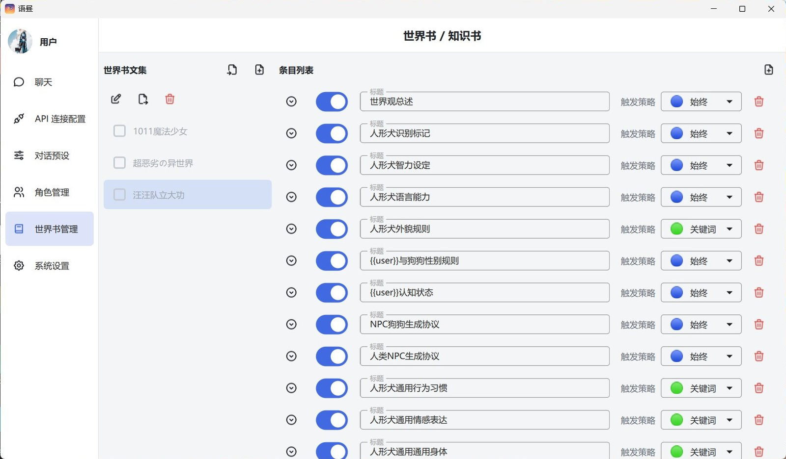

# 语昼 Yuzora

**Qt 6 / QML 写的本地优先 AI 角色扮演客户端（Windows + Android）。**


[](https://github.com/zulsl/Yuzora/actions/workflows/build.yml)

角色卡、开场白、世界书、对话预设和流式生成都在同一个原生应用里完成；所有数据存在本机 SQLite，请求只发给你自己配置的 API。桌面和手机共用同一套 QML，界面按宽度自适应（宽屏左右分栏、窄屏单栏）。


## 功能

- **角色卡**：导入 / 导出 PNG 与 JSON 角色卡（兼容 V1 / V2 规格），带姓名、描述、人格、场景、示例对话、作者与标签等字段。
- **开场白**：首选开场白与多条备选开场白，同一个会话内可随时切换。
- **世界书**：文集 → 条目两层结构，支持关键词、常驻、递归触发，以及「角色定义前 / 后」「按深度插入」「示例消息」「作者注释」等多种注入位置。
- **对话预设**：提示词条目可启用 / 禁用、可拖动排序（长按拖动或行首手柄），新条目可追加或插入到选中项之前，支持 marker 与宏；可直接导入 SillyTavern 的预设文件。
- **流式生成**：逐字输出、随时中断；失败时给出分类后的错误卡片（网络 / Key / 模型名 / 网关页各不相同）和可展开的技术详情。
- **消息管理**：右键或长按删除单条消息，重新生成最后一条回复（失败与取消的占位也能重试）。
- **多 API 配置**：内置 OpenAI / DeepSeek / GLM / 豆包等 OpenAI 兼容配置，也可新建任意兼容端点，各自独立保存 API Key、Base URL、接口路径与模型列表。
- **本地优先**：全部数据在本地 SQLite，带版本化表结构迁移与升级前自动备份；设置里可一键清除所有数据。
- **界面**：Qt Quick 自适应布局，浅色 / 深色 / 跟随系统三种主题，桌面（鼠标右键、悬停提示）与触屏（长按、拖动、震动反馈）两套交互。

## 界面

<p align="center">
  
  <sub>角色管理</sub>
</p>

<p align="center">
  
  <sub>世界书</sub>
</p>

## 技术栈与架构

| 层 | 负责什么 | 位置 |
| --- | --- | --- |
| QML 视图 | 界面、动效、平台手势（长按拖动 / 右键菜单 / 震动） | `qml/` |
| ViewModel | 把 UI 意图翻译成命令，持有草稿与脏标记 | `src/viewmodel/` |
| Service | 业务规则：提示词装配、角色卡解析、世界书匹配、导入导出 | `src/model/service/` |
| DAO / Entity | SQLite 读写与实体映射，事务边界 | `src/model/dao/`、`src/model/entity/` |
| 跨平台 | Android 权限、震动、路径、文件选择 | `src/crossplatform/` |

几个刻意的设计：

- **数据访问走 `IConnectionProvider` 注入**：DAO 不直接拿单例连接，测试里可换成内存 SQLite（20 个测试目标里有 7 个是 Service / DAO 级测试，全靠这一点）。
- **列表模型独立成类**（`src/model/list/`）：不用 `QVariantList` 拼 UI，行内编辑、展开状态、拖动重排都有明确的所有者。
- **版本号只有一个来源**：`project(Yuzora VERSION x.y.z)`，C++ 侧走 `APP_VERSION` 宏，Android 侧走 `QT_ANDROID_VERSION_CODE/NAME` + 清单占位符，打 tag 时 CI 自动出包。

## 工程实践

- **CI / 发版**：`build.yml` 在每次 push / PR 时装 Qt 6.8.3、编译并跑全部 20 个测试；`android.yml` 手动触发时交叉编译 arm64 APK 并签名；`release.yml` 在打 `v*` tag 时同时产出 **Windows 压缩包 + 签名 APK**，自动创建/更新 Release 并附提交摘要。签名密钥只存在仓库 Secrets，不进仓库也不落 runner 磁盘。
- **测试**：19 个 C++ 单元测试（ctest 计 20 项，含一个 Python 工具自测）覆盖 DAO / Service / 提示词装配 / 宏引擎 / 迁移 / 世界书匹配。Qt 的 DLL 路径从 `Qt6_DIR` 推导，不写死本机目录，换机器和 CI 都能直接跑。
- **与 SillyTavern 做差分**：`tools/` 下的脚本抓 ST 实际发出的请求体、预设与世界书导出物，和本项目的产物逐字段比对（`prompt_diff.py` 自带 `--selftest`，已接入 ctest）。对齐不是靠感觉，而是靠把两边的 JSON 摆在一起 diff。
- **可移植性**：Android 的 OpenSSL 路径可覆盖（`-DANDROID_OPENSSL_DIR=...`），找不到只告警不中断；`.gitignore` 排除签名密钥，密钥只走 CI Secrets。

## 构建与运行

**前置条件**

| 依赖 | 版本 |
| --- | --- |
| Qt | 6.8 及以上（开发与测试使用 6.8.3） |
| 编译器 | Windows：MSVC 2022；Android：NDK r26b (26.1.10909125) |
| CMake | 3.18 及以上 |
| JDK | 17（仅 Android） |

Qt 组件：`Core` `Gui` `Quick` `QuickControls2` `Network` `Sql`。

**Windows**

```powershell
cmake -B build -G Ninja -DCMAKE_BUILD_TYPE=Release
cmake --build build --parallel
# 打包成可直接分发的目录（Qt DLL + QML 模块）
windeployqt --release --compiler-runtime --qmldir qml build\Yuzora.exe
```

**Android（arm64）**

需要 Qt for Android 6.8.3、NDK 26.1.10909125，以及 [android_openssl](https://github.com/KDAB/android_openssl)（用于 HTTPS）。

```powershell
cmake -B build-android -G Ninja -DCMAKE_BUILD_TYPE=Release `
  -DCMAKE_TOOLCHAIN_FILE="$env:QT_ANDROID/lib/cmake/Qt6/qt.toolchain.cmake" `
  -DQT_HOST_PATH="$env:QT_HOST" `
  -DANDROID_OPENSSL_DIR="D:/Qt/Android/SDK/android_openssl"
cmake --build build-android --target apk
```

产物在 `build-android/**/build/outputs/apk/release/`。签名后的 APK 见 [Releases](https://github.com/zulsl/Yuzora/releases)。

## 测试

```powershell
cmake -B build -DBUILD_TESTING=ON
cmake --build build
ctest --test-dir build --output-on-failure
```

## 数据与隐私

- 数据库位于 `%APPDATA%\Yuzora\Yuzora_data.db`，头像在 `%APPDATA%\Yuzora\avatars\`（可在设置中改用自定义数据目录）。
- 除你自己配置的 API 服务之外，应用不会把内容发往任何第三方；开发者不运营任何业务服务端。
- API Key 以明文保存在本地数据库中，不会加密。公用电脑上请不要保存敏感 Key。（后续计划改用系统密钥库。）
- 唯一的外部请求是「关于」页里手动触发的 GitHub 版本检查。

## 与 SillyTavern 的关系

语昼的提示词装配沿用 SillyTavern 的 `prompt_order` / `prompt collection` 模型，目标是把发给模型的 Chat Completion 请求体与 ST 1.19 逐条对齐。

**可以直接导入的数据**：ST 角色卡（含 V2 `character_book`）、ST 对话预设 JSON、ST 世界书 JSON（以 `entries` 内部格式为主）。同名预设就地覆盖、同名世界书就地替换（book id 不变，角色绑定不会断）。

## 已知限制

- 世界书条目列表的显示顺序目前是数据库自然行序，与影响拼装的「插入顺序」是两个概念，尚未在 UI 上分开（预设里的提示词条目已经支持拖动排序）。
- 仅提供 arm64 Android 包；模拟器需要用 x86_64 自行构建。
- 不做云同步，所有数据只在本机。

## 反馈与交流

- 问题与建议：GitHub [Issues](https://github.com/zulsl/Yuzora/issues)
- 反馈问题时附上 `%APPDATA%\Yuzora\logs\` 里对应日期的日志会快很多
- 交流群：QQ `767201901`

## 许可证

本项目以 [GPL-3.0](LICENSE) 发布。运行时动态链接 Qt 6.8.3（LGPLv3）；数据库使用 SQLite，HTTPS 走 Qt 的 TLS 后端（OpenSSL / Schannel）。
